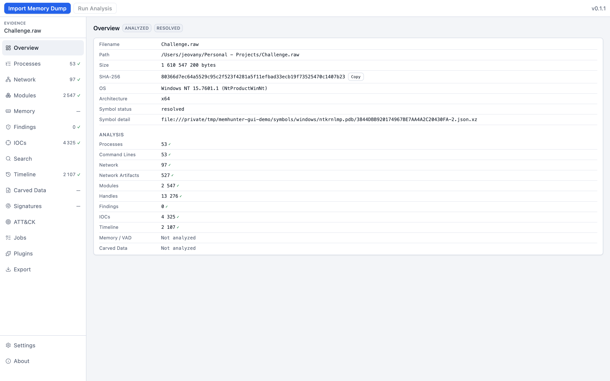
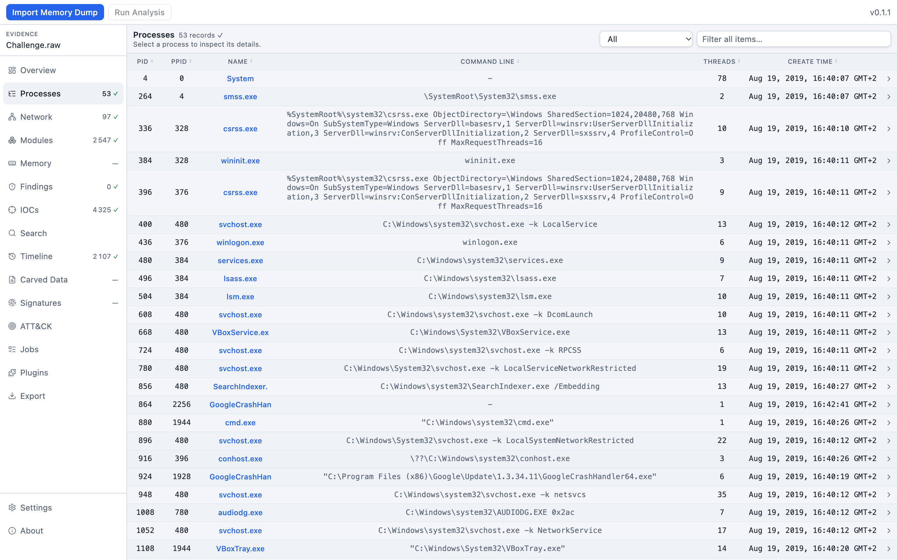
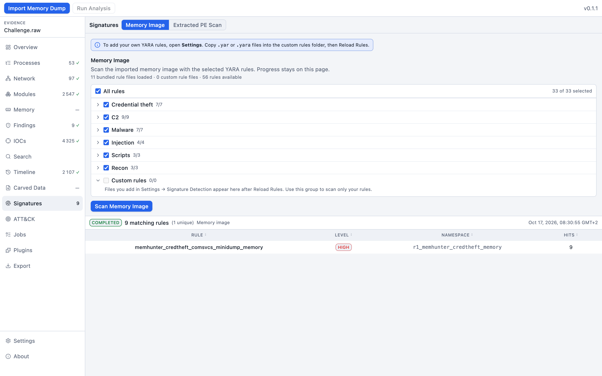
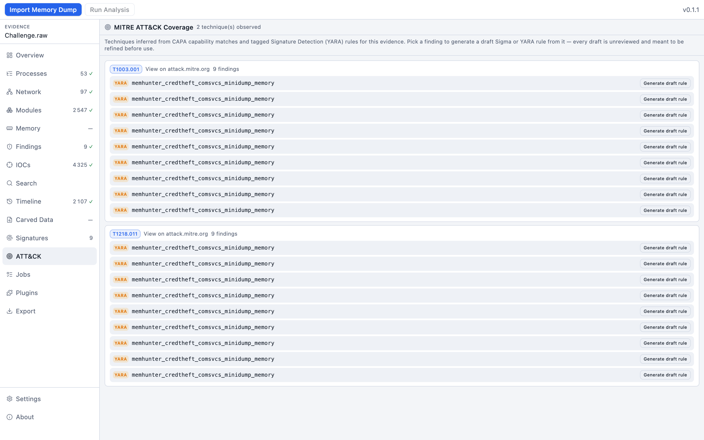

# MemHunter

[](https://github.com/Eizi0/memhunter/releases/latest)
[](https://github.com/Eizi0/memhunter/actions/workflows/linux-build.yml)

**[Download the latest release](https://github.com/Eizi0/memhunter/releases/latest)** — Windows
installer (`.exe`), Linux `.deb`, and Linux AppImage, all built and published automatically from
source by `.github/workflows/release.yml`.

A local-first memory forensics workbench for DFIR, threat hunting, and malware triage. No cloud,
no account, no telemetry — the memory image never leaves your machine. MemHunter does not score
malware: YARA matches, CAPA capabilities, and carved strings are investigation leads, not
verdicts.

MemHunter builds on the engine architecture of [Dumplyzer](https://github.com/EmadAbedini/Dumplyzer)
(Apache-2.0 — see `NOTICE`), extended with three things that engine didn't have:

- **A real CLI.** `memhunter import`, `memhunter analyze`, `memhunter report` — script a triage
  pipeline, run it in CI, or drive it from an incident-response runbook. Everything the desktop
  app can do, the CLI can do headless.
- **MITRE ATT&CK mapping and draft detection rules.** Every CAPA capability and tagged YARA match
  is mapped to an ATT&CK technique. From any finding, generate a starting-point Sigma or YARA
  rule — labeled a draft to refine, not a finished detection, in keeping with the project's
  "indicators, not verdicts" stance.
- **Native Linux support.** Linux memory images get the same guided analysis profile Windows
  images do (process list, command lines, network, modules), not just raw Plugin Explorer access.

## Screenshots

Real run against a public DFIR memory-forensics challenge image — genuine LSASS credential-dump
finding (`comsvcs.dll` MiniDump), mapped to ATT&CK, with a generated draft Sigma rule.

| | |
|---|---|
|  |  |
|  |  |

More: [Network](docs/screenshots/04-network.png) ·
[Draft Sigma rule](docs/screenshots/07-attck-draft-rule.png) ·
[Empty state](docs/screenshots/01-empty-state.png)

## Why this exists

Forensic analysis that stays in your head, or in a GUI you have to screenshot, doesn't make it
into a detection rule. MemHunter exists to close that loop: analyze a memory image, see what
ATT&CK techniques it demonstrates, and walk away with a rule draft — not just a report.

## Install

See `engine/README.md` for the Python engine (CLI + analysis core) and `app/desktop/` for the
optional Tauri desktop shell. Both consume the same `memhunter_engine` package.

```bash
cd engine
python3.12 -m venv .venv
source .venv/bin/activate   # .venv\Scripts\activate on Windows
pip install -e ".[dev]"
memhunter --help
```

The desktop app (`app/desktop/`) builds a Windows NSIS installer and, since this fork, Linux
`.deb`/AppImage bundles too — see `scripts/windows/` and `scripts/linux/` for the tool-prep
scripts that fetch and pin CAPA/FLOSS/bulk_extractor/Python for each platform, and
`.github/workflows/linux-build.yml` for the Linux CI build.

## Usage

**[docs/USAGE.md](docs/USAGE.md)** — the desktop workflow (import → analyze → Signatures/CAPA →
ATT&CK → draft rule → export) and the full CLI walkthrough with real command output, including a
headless triage-pipeline script.

## Architecture

Same shape as the engine this project builds on — see `ARCHITECTURE.md` for the full picture
(data model, job queue, provider pattern, IPC). In short:

```
CLI or React + Tauri shell
        │  direct Python import, or JSON-RPC NDJSON over stdio
Python engine (engine/memhunter_engine)
        │  Volatility 3 APIs, optional tool processes (CAPA, FLOSS, bulk_extractor)
Memory image on disk (read-only; never copied into the install tree)
```

## License and attribution

Apache-2.0 — see `LICENSE`. This project is derived from Dumplyzer; see `NOTICE` for the required
attribution. Volatility 3 (Volatility Software License 1.0) and other bundled tools keep their own
licenses — see `THIRD_PARTY_NOTICES.md`. Because Volatility 3's license requires that wrappers
built on it stay source-available, **MemHunter is and will remain open source.**
